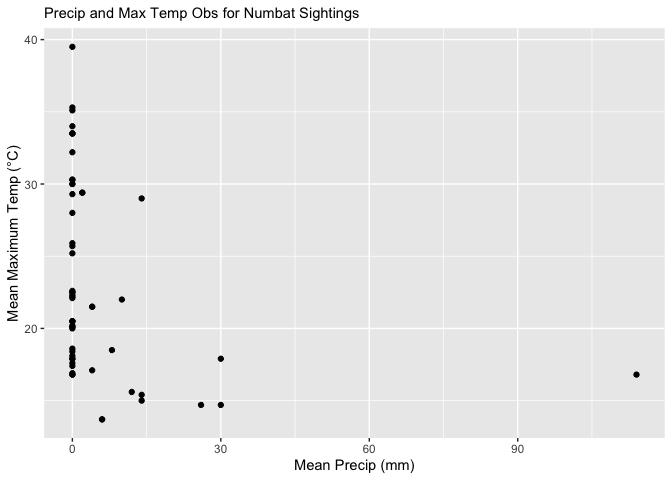
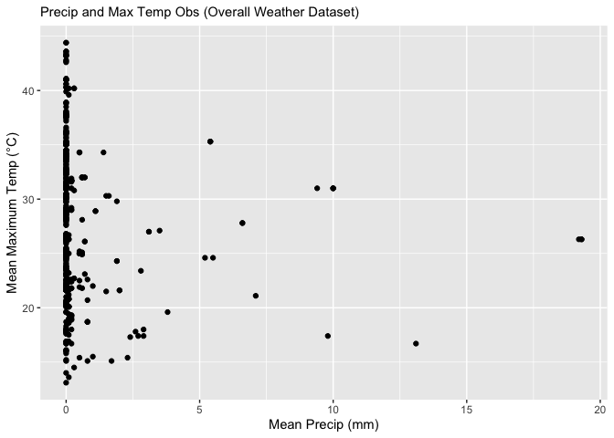
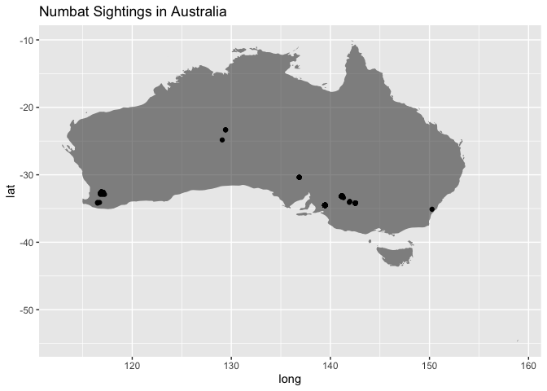

# GEOG 4300 Midterm Data Sprint_Grayson Smith


*Chunk 1*: Loading the required packages, including the tidyverse for
data manipulation. Although I loaded terra and sf, I only used sf once
to load in Australia’s borders, and I did not use terra (and thus, I
removed it below). I originally intended to do a more spatially-focused
analysis for this data sprint; however, I was limited by data
availability and my own ability. I will certainly work to improve in the
spatial analysis area.

``` r
library(tidyverse)
```

    ── Attaching core tidyverse packages ──────────────────────── tidyverse 2.0.0 ──
    ✔ dplyr     1.2.1     ✔ readr     2.2.0
    ✔ forcats   1.0.1     ✔ stringr   1.6.0
    ✔ ggplot2   4.0.3     ✔ tibble    3.3.1
    ✔ lubridate 1.9.5     ✔ tidyr     1.3.2
    ✔ purrr     1.2.2     
    ── Conflicts ────────────────────────────────────────── tidyverse_conflicts() ──
    ✖ dplyr::filter() masks stats::filter()
    ✖ dplyr::lag()    masks stats::lag()
    ℹ Use the conflicted package (<http://conflicted.r-lib.org/>) to force all conflicts to become errors

``` r
library(sf)
```

    Linking to GEOS 3.13.0, GDAL 3.8.5, PROJ 9.5.1; sf_use_s2() is TRUE

*Chunk 2*: In this chunk, I utilized Dr. Shannon’s script to read in the
numbats data and weather data (using the weatherOz package). It appears
that this chunk works to first manipulate the numbats data – including
via the addition of a 0 to the month data to put it in a format
consistent with the weather data. From there, weather data is extracted
using the SILO API to get a more complete record of weather data – given
that the weather data provided in the numbat sightings is very
incomplete. After that, an attempt was made to join the weather and
numbat datasets; however, the lack of an exact-matching field with which
the join could be peformed made this task difficult (and thus it was not
completed).

``` r
#Using Dr. Shannon's script to get wx data in:

#install.packages("weatherOz")
library(weatherOz)
```


    Attaching package: 'weatherOz'

    The following object is masked from 'package:graphics':

        plot

    The following object is masked from 'package:base':

        plot

``` r
numbat_data<-read_csv("data/numbats.csv") %>%
  filter(!is.na(eventDate)) %>%
  mutate(event_oz=paste0(year(eventDate),
                         str_pad(month(eventDate),2,pad="0"),
                         str_pad(day(eventDate),2,pad="0")))
```

    Rows: 805 Columns: 17

    ── Column specification ────────────────────────────────────────────────────────
    Delimiter: ","
    chr  (8): scientificName, taxonConceptID, recordID, dataResourceName, occurr...
    dbl  (7): decimalLatitude, decimalLongitude, year, hour, prcp, tmax, tmin
    dttm (1): eventDate
    date (1): day

    ℹ Use `spec()` to retrieve the full column specification for this data.
    ℹ Specify the column types or set `show_col_types = FALSE` to quiet this message.

``` r
summary(numbat_data)
```

     decimalLatitude  decimalLongitude   eventDate                  
     Min.   :-35.10   Min.   :116.5    Min.   :1856-12-31 13:55:08  
     1st Qu.:-34.51   1st Qu.:139.4    1st Qu.:2013-12-13 13:00:00  
     Median :-34.20   Median :139.5    Median :2016-10-15 01:00:00  
     Mean   :-33.72   Mean   :137.3    Mean   :2014-08-21 20:07:43  
     3rd Qu.:-33.17   3rd Qu.:141.2    3rd Qu.:2019-11-07 19:00:00  
     Max.   :-23.33   Max.   :150.3    Max.   :2023-02-18 01:12:00  
     NAs    :15       NAs    :15                                    
       scientificName   taxonConceptID      recordID    dataResourceName
     Length   :552    Length   :552    Length   :552   Length   :552    
     N.unique :  2    N.unique :  2    N.unique :552   N.unique : 12    
     N.blank  :  0    N.blank  :  0    N.blank  :  0   N.blank  :  0    
     Min.nchar: 21    Min.nchar: 73    Min.nchar: 36   Min.nchar: 16    
     Max.nchar: 27    Max.nchar: 73    Max.nchar: 36   Max.nchar: 58    
                                                                        
                                                                        
      occurrenceStatus      year            month            wday    
     Length   :552     Min.   :1856   Length   :552   Length   :552  
     N.unique :  1     1st Qu.:2013   N.unique : 12   N.unique :  7  
     N.blank  :  0     Median :2016   N.blank  :  0   N.blank  :  0  
     Min.nchar:  7     Mean   :2014   Min.nchar:  3   Min.nchar:  3  
     Max.nchar:  7     3rd Qu.:2019   Max.nchar:  3   Max.nchar:  3  
                       Max.   :2023                                  
                                                                     
          hour            day                  dryandra        prcp        
     Min.   : 0.00   Min.   :1856-12-31   Length   :552   Min.   :  0.000  
     1st Qu.:13.00   1st Qu.:2013-12-13   N.unique :  2   1st Qu.:  0.000  
     Median :13.00   Median :2016-10-14   N.blank  :  0   Median :  0.000  
     Mean   :12.42   Mean   :2014-08-21   Min.nchar:  2   Mean   :  5.593  
     3rd Qu.:13.00   3rd Qu.:2019-11-07   Max.nchar:  3   3rd Qu.:  4.000  
     Max.   :22.00   Max.   :2023-02-18   NAs      : 15   Max.   :114.000  
                                                          NAs    :493      
          tmax            tmin             event_oz  
     Min.   :137.0   Min.   :  9.00   Length   :552  
     1st Qu.:179.0   1st Qu.: 44.00   N.unique :257  
     Median :215.0   Median : 63.00   N.blank  :  0  
     Mean   :229.8   Mean   : 83.23   Min.nchar:  8  
     3rd Qu.:293.0   3rd Qu.:121.00   Max.nchar:  8  
     Max.   :395.0   Max.   :175.00                  
     NAs    :495     NAs    :495                     

``` r
x <- get_data_drill(
  longitude  = 153.0,
  latitude   = -27.5,
  start_date = "20240101",
  end_date   = "20241231",
  values     = c("max_temp", "min_temp", "rain"),
  api_key    = "jshannon@uga.edu"
)

numbat_wx<-function(row_sel){
  numbat_sel<-numbat_data[row_sel,]
  
  get_data_drill(
    longitude=numbat_sel$decimalLongitude,
    latitude=numbat_sel$decimalLatitude,
    start_date=numbat_sel$event_oz,
    end_date=numbat_sel$event_oz,
    values     = c("max_temp", "min_temp", "rain"),
    api_key    = "jshannon@uga.edu"
  ) %>%
    rename(decimalLatitude=latitude,
           decimalLongitude=longitude,)
}

#nrow_plus1 <- nrow(numbat_data) + 1 #Did not work, was trying to experiment with the dates

weather_data<-map_df(1:nrow(numbat_data),possibly(numbat_wx))
#numbat_wx<-numbat_data %>%
  #rename(date=day) %>%
  #left_join(weather_data)
```

*Chunk 3*: In this chunk, I aimed to plot the max temp and precip
observations for each numbat sighting that recorded weather data. The
goal of this, albeit very simple, exercise, was to determine if there
was any meaningful pattern in either the temp or precip recorded on the
days that numbats were spotted.

To accomplish this, I first cleaned the numbats data (using the variable
`numbats_cleaned`) to remove all observations that were missing data for
precip or max temp. I then mutated the max temp readings (by dividing
each value by 10) to get a decimal point into the reported values (as
they previously lacked one, and were thus reporting temp values in the
hundreds of degrees Celsius \[i.e., the raw data listed the temp as
300°C, where the actual reading should be 30.0°C\]).

From there, I created a very simple visual (as given below the code
chunk) that depicted the precip value (on the x-axis) and the max temp
value (on the y-axis) for each numbat sighting. An analysis of that
visualization is left for the discussion section.

``` r
#Trying to plot the data for numbat sightings vs. precip (in some way)

#Without the weather_data, just the wx data in numbat_data

numbats_cleaned <- numbat_data %>%
  filter(prcp != "NA") %>%
  filter(tmax != "NA") %>%
  mutate(tmax_corr = tmax/10)

ggplot(numbats_cleaned,
       aes(x=prcp, 
           y=tmax_corr)) +
  geom_point() +
  ggtitle("Precip and Max Temp Obs for Numbat Sightings") +
  theme(
    plot.title = element_text(size = 11)) +
  xlab("Mean Precip (mm)") +
  ylab("Mean Maximum Temp (°C)") #Had to do this to capitilize "region" in the legend. 
```



*Chunk 4*: In this chunk, I create a very similar (and again, very
simple) graphic to show the max temp and precip data for all the weather
data gathered in Chunk 2. An explanation of this graphic is provided in
the discussion.

``` r
#Plotting the wx_data

ggplot(weather_data,
       aes(x=rainfall, 
           y=air_tmax)) +
  geom_point() +
  ggtitle("Precip and Max Temp Obs (Overall Weather Dataset)") +
  theme(
    plot.title = element_text(size = 11)) +
  xlab("Mean Precip (mm)") +
  ylab("Mean Maximum Temp (°C)") 
```



*Chunk 5*: Here, I begin by loading in a simple shapefile of Australia’s
borders (using the original `australia_borders` variable) using st_read.
However, Will (2) showed me an even more intuitive way of getting that
geographic information (apparently also including a shaded area for the
country, using the map_data function), so I ended up using data from
that source. I only maintained the previous version of data retreival
for reference purposes.

After that, I created another plot that leverages the above-mentioned
Australia geographic information to plot numbat observations across the
country. The numbat sightings are given by the black dots.

It should also be noted that I attempted to find a raster of Australia
precip data to overlay onto this map – just to demonstrate that numbats
tend to live in areas devoid of precip (which also makes sense on an
intuitive sense) – however, I ran into data availability and time
constraints. Nevertheless, I did attach an image to my repo that
contains that precip data (just for reference). That file is titled
“Australia precip data_Australia BOM” and is sourced from the Australia
Bureau of Meteorology.

Further, it should be noted that all the numbat observations that had
meteorological data occurred in the extreme SW part of Australia. I
included rthe remainder of the observations for reference.

``` r
#Trying to plot the numbat obs on a map of Australia to prove the obvious -- numbats are found in desert areas that, unsurprisingly, do not get much rain. 

#australia_borders <- st_read("data/AUSTRALIA SHAPEFILE/AUSTRALIA_Shapefiles/Australia_adm/Australia_adm01.shp") %>%
  #st_transform(4326)

australia_borders <- map_data("world",region = "Australia")

ggplot() +
  geom_polygon(data=australia_borders,
               aes(x=long,
                   y=lat,
                   group=group,
                   alpha=0.5)) +
  geom_point(data=numbat_data,
             aes(x=decimalLongitude,
                 y=decimalLatitude)) +
  guides(alpha = "none") +
  labs(title = "Numbat Sightings in Australia")
```

    Warning: Removed 15 rows containing missing values or values outside the scale range
    (`geom_point()`).



**Discussion**

*Introduction*

A brief description of the dataset and its main variables. The research
question you are trying to answer related to this dataset.

Response: For this activity, I utilized the numbats dataset we chose in
class. This dataset includes data on numbat sightings across Australia,
including their location, scientific name, date, and a limited amount of
weather data (like temp and precip).

The research question I was attempting to answer was examining the
relationship between numbat sightings and weather conditions. My
original question was trying to just evaluate the relationship between
numbats and precip amounts; however, I pivoted to the above mentioned
question (looking at the broader relationship between numbat sightings
and weather observations). Specifically, I eventually attempted to
answer whether there is any difference in temp and precip distribution
for numbat sightings compared to the overall temp and precip
distribution.

*Analysis*

A section in which you answer that question using R coding skills you’ve
learned. This will include code chunks as well as brief description of
what each of those code chunks is doing. This section should include at
least two visualizations (graphs/maps) relevant to your research
question.

Response: The analysis of my code chunks – and my visualizations – is
provided above.

*Discussion*

Explains how you would answer your research question based on your
analysis. Make specific reference to the results in your analysis
section that support this answer.

Response: Based on my analysis section, I found that the max temp and
precip distributions for numbat sightings does not vary meaningfully
from the overall distribution of those variables. This is demonstrated
by the fact that there is a very similar distribution of both variables
between my first and second visualization (using the numbat weather data
and overall weather data, respectively). I should note that I have very
low confidence in the values reported – especialy for precip – in the
numbats dataset, given that this data appears to report rainfall that is
far higher than given in the overall weather data from SILO (including
one observation well over 90 mm, when the overall weather data has no
observations anywhere close to that value). In any case, the general
distribution appears to be the same, suggesting that there is no
meaningful difference between the weather numbats prefer and the overall
spread of weather in those areas that numbats are sighted.

In the end, this finding is not particularly interesting or surprising –
and certainly indicates to me that I should’ve chosen better methods
and/or a better question.

*Tie to class*

Explain how this exercise shows what you’ve learned in the class thus
far, mentioning at least three relevant learning standards.

Response:

I believe that I demonstrated the following competencies – at least in
part – from completing this lab:

1.  Identify and apply appropriate data filtering and cleaning
    strategies to prepare datasets for analysis. (Labs 0, 1, 3, 4)

- I think I demonstrated this skill by filtering the data in Chunk 3,
  along with the general strategy of knowing what steps to take (even if
  they were simple) to properly analyze the data.

2.  Derive new variables from existing ones through calculated
    transformations, including unit conversions, differences across time
    periods, and categorical dummy variables.

- Again, although my demonstration of this skill was simple, I used this
  skill when I used mutate() in Chunk 3 in order to get the temp data to
  be more realistic.

3.  Create effective data visualizations across multiple chart types
    (line, scatter, histogram, Q-Q plot), applying appropriate aesthetic
    choices such as color, grouping, and labeling. (Labs 1, 3, 4, 5)

- I, again simply, used this skill in all my visualizations given above.
  None of them have any notable color because I did not group the data
  (since I was looking at precip and temp for the observations as a
  whole, not a particular subset thereof). Given my figures were pretty
  simple, I also did not make too many aesthetics changes; however, I
  was able to add a title to each graphic to make them visually
  appealing and informational. Together, I would have hoped to
  demonstrate more advnaced skills in this area (as we have in the
  labs); however, my very simple research question (and limitations
  imposed by time and my ability) precluded that here. I certainly aim
  to improve in future data sprints.

4.  Recognize and be able to manipulate multiple data object types
    (vectors, data frames, or lists). (Labs 0, 1, 2, 3, 4, 5, 6)

- Although simply, I demonstrated this skill here by dealing with both
  data frames and vector data (i.e., the Australian borders dataset and
  the points-based numbat spatial data).

In general, I think I also demonstrated that I could analyze patterns in
data – even if the patterns here were not all that complicated or
surprising.

Overall, although I was able to demonstrate the above competencies in a
limited way through this exercise, I certianly hope to improve that
usage in the future. Time and data were certainly a limitation; however,
I aim to overcome those challenges in future exercise like this, and to
make an attempt to use some of the more advanced techniques we’ve
covered in class in future analyses. In any case, this exercise
certainly was helpful in gauging my current skill level, and I will aim
to make it further learning material in the labs and other data analysis
activities to come.

*NOTE*: I also apologize for the delay in submission. Please let me know
if this is an issue – or if there is any issue with the content above –
and I will absolutely attempt to fix them.

Thank you!
